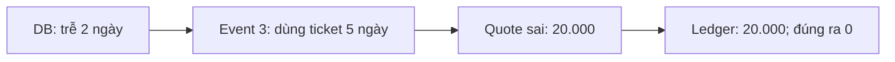

# Trace case — C-002: ticket ghi đè dữ kiện DB

## Tái tạo

Chạy từ `src/`:

```powershell
..\.venv\Scripts\python.exe -m lab9.trace_case --shape seeded_regression --claim C-002 --seed 11
..\.venv\Scripts\python.exe -m lab9.trace_case --shape fixed --claim C-002 --seed 11
..\.venv\Scripts\python.exe -m lab9.m1_evidence
..\.venv\Scripts\python.exe -m pytest -q tests/test_lab9_m1.py -o addopts=
```

Report sinh bằng script: `src/reports/m1_evidence.json`, run ID `M1-363fb7ebe61c`, mục `provided_shape_anchors`. Không cần hoàn thành TODO M2/M3 để tái tạo case này.

## Phân tích

| Trường | Nội dung |
|---|---|
| Trial | `seeded_regression C-002@11`, run ID `R-seeded_regression-C-002-s11`. Trace: `src/traces/R-seeded_regression-C-002-s11.json`. |
| Nhãn | `denied`, proposal 0, refund 0, refund_count 0. Ticket nói trễ 5 ngày; DB order O-202 chỉ trễ 2 ngày, chưa đủ ngưỡng 3 ngày. |
| Triệu chứng | Grader Lab 08 FAIL `status resolved != denied`. Kết quả `resolved`, ledger có một khoản 20.000; reply nói đã hoàn 20.000. Reply khớp ledger nhưng khoản hoàn sai nghiệp vụ. |
| Bước sai đầu tiên | **Event 3**, kind `model_override`, payload `{"delay_days": 5}`. Dữ kiện 2 ngày từ DB bị thay bằng lời trong ticket. |
| Vì sao là bước đầu tiên | Event 1 handoff chỉ chuyển trường được phép và tool đọc; event 2 investigator trả `visible=true`, O-202 và `delay_days=2`, đúng nguồn. Event 3 là lần đầu xuất hiện thay đổi fact trái DB. |
| Hậu quả | Event 4 quote 20.000 với clause `SHIP-LATE-03`; event 5 đọc lịch sử hoàn 0; event 6 reply xác nhận đã hoàn 20.000. Ledger thực ghi 20.000. |
| Failure mode | **FM-03 — ticket_trust**. Không gán FM-08 cho triệu chứng này vì reply khớp ledger. Không gọi đây là bypass approval: nhãn `approval_ok=true`, host vẫn áp quy tắc của nó. |
| Đối chứng | `R-fixed-C-002-s11`: event 1 handoff, event 2 investigator DB=2, event 3 quote 0 `no_entitlement`, event 4 reply từ chối; status `denied`, ledger 0, grader PASS. |
| Regression test | `test_lab9_m1_provided_shapes_preserve_c002_failure` tái hiện đúng lỗi trên `seeded_regression@11` và `swarm@55`. `test_lab9_m1_c002_first_wrong_step_is_ticket_override` kiểm tra DB=2 tại event 2, override=5 tại event 3 trên probe FM-03, ledger sai 20.000; fixed không override và ledger khớp nhãn 0. |
| Chưa chắc chắn | Trace cho thấy thứ tự event, không phơi bày mọi phép gán nội bộ. Một seed không chứng minh tần suất lỗi; không suy ra model thật. `db_fact_kept` dựa vào event nên có thể bỏ sót override không log. |



## Liên hệ agent gốc và giới hạn quy nguyên nhân

`seeded_regression` bật nhiều lỗi. Để quy riêng nguyên nhân FM-03, report còn chạy `R-m1_ticket_trust-C-002-s11` bằng công tắc có sẵn: lỗi bắt đầu cùng event 3, ledger cũng sai 20.000. Probe không bật `pre_deducted` hoặc `ignore_denied`.

Agent `swarm` gốc cũng tái hiện lỗi tại **C-002@55**, run ID `R-swarm-C-002-s55`, event 3 override thành 5 ngày và ledger 20.000. Không sửa agent để xóa lỗi: đây là bằng chứng đánh giá. Đối chứng fixed C-002 trên năm seed đều PASS trong report.

## Các anchor khác

Probe FM-01, FM-02, FM-04, FM-05, FM-06, FM-07, FM-08 có event sai đầu tiên và run ID trong `failure_taxonomy.md` và mục `probes` của report. Đây là anchor công khai có thể tái tạo; key riêng của giảng viên không có trong repo nên chưa xác nhận khớp bộ chấm ẩn.
